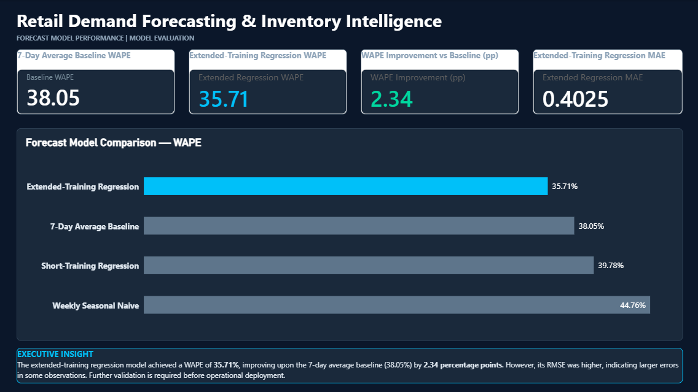
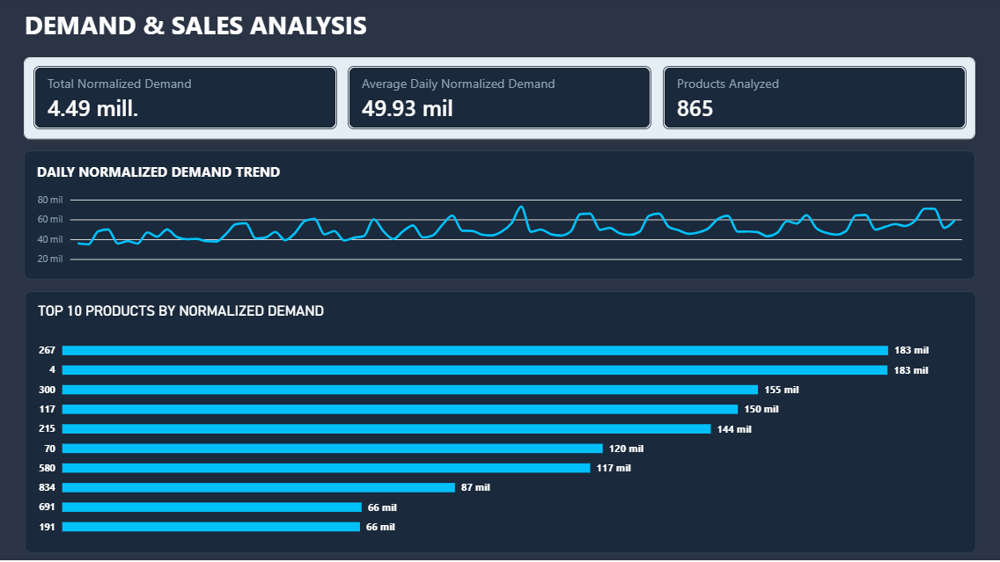
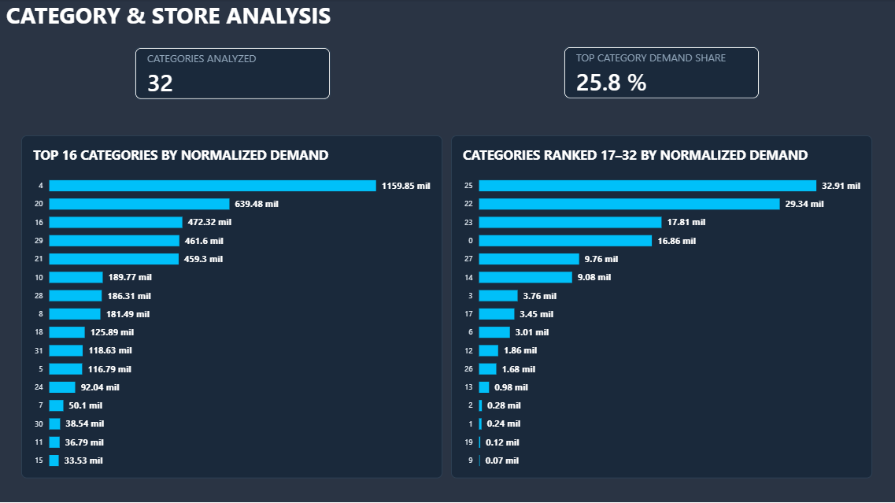
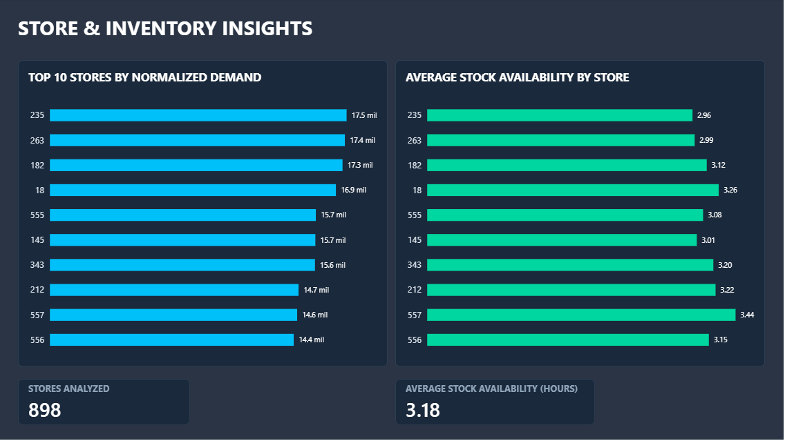

# Retail Demand Forecasting & Inventory Intelligence

An end-to-end retail analytics project combining data quality assessment, demand analysis, inventory intelligence, and predictive modeling using PostgreSQL, SQL, Python, and Power BI.

---

## Executive Overview

This project analyzes 4.5 million retail observations from the FreshRetailNet-50K dataset to investigate normalized demand patterns, evaluate inventory-related indicators, and compare forecasting approaches.

The analytical workflow combines SQL-based data validation, Python data processing and predictive modeling, and an interactive Power BI dashboard.

## Power BI Dashboard

### 1. Forecast Model Performance



Comparison of forecasting approaches using MAE, RMSE, and WAPE to evaluate predictive performance against a baseline.

### 2. Demand & Sales Analysis



Analysis of normalized observed demand across the dataset, including daily trends and product-level indicators.

### 3. Category & Store Analysis



Exploration of demand distribution across product categories and retail stores.

### 4. Store & Inventory Insights



Store-level demand analysis and examination of inventory-related indicators.

---

## Business Objectives

- Analyze daily normalized demand across retail stores and products.
- Assess data quality, completeness, and consistency.
- Identify demand patterns across products, categories, and stores.
- Explore inventory-related indicators and their relationship with demand.
- Evaluate predictive models against baseline forecasting methods.
- Communicate analytical findings through interactive dashboards.

## Dataset

**Source:** [FreshRetailNet-50K — Hugging Face](https://huggingface.co/datasets/Dingdong-Inc/FreshRetailNet-50K)

The training dataset contains:

- 4,500,000 observations.
- 50,000 city-store-product time series.
- 90 consecutive days, from March 28 to June 25, 2024.
- 19 original columns, including daily sales, hourly sales, inventory-related indicators, discounts, and calendar variables.

The original dataset is not included in this repository due to its file size. Please download it from the source above.

**Data interpretation:** The `sale_amount` field represents normalized observed sales/demand, not monetary revenue or physical units sold. The `stock_hour6_22_cnt` field is treated as a stock-status hours count; its precise operational interpretation has not been conclusively confirmed.

## Data Quality & Validation

The project includes:

- Missing-value and null checks.
- Hourly array completeness and length validation.
- Daily time-series continuity checks.
- Descriptive statistics and unusual-value investigation.
- Discount values outside the expected range.
- Product, category, and store-level analysis.

Hourly arrays were validated across all 4.5 million observations. Each record contained 24 hourly elements, with no missing or invalid elements detected.

## Forecasting & Model Evaluation

Four approaches were evaluated:

| Model | MAE | RMSE | WAPE |
|---|---:|---:|---:|
| 7-Day Average Baseline | 0.428854 | 0.720024 | 38.05% |
| Weekly Seasonal Naive | 0.504444 | 0.848539 | 44.76% |
| HistGradientBoosting Regression | 0.448300 | 0.838080 | 39.78% |
| Extended-Training Regression | 0.402450 | 0.914855 | 35.71% |

The extended-training regression model achieved the lowest WAPE, improving upon the 7-day average baseline by 2.34 percentage points. However, its RMSE was higher, indicating larger errors in some observations.

These findings support further model investigation and validation rather than an assumption of operational readiness.

## Technologies

- **PostgreSQL** — data staging, validation, and analytical queries.
- **SQL** — aggregations, data quality checks, and time-series analysis.
- **Python** — data processing, profiling, and predictive modeling.
- **Power BI** — interactive dashboards and performance reporting.

## Repository Structure

```text
retail-demand-forecasting-inventory-intelligence/
│
├── documentation/
├── images/
├── powerbi/
├── python/
├── reports/
└── sql/
```

## Project Status

The analytical workflow, SQL analysis, predictive model evaluation, and Power BI dashboard have been developed.

This project demonstrates practical skills in retail analytics, data quality assessment, SQL, business intelligence, and demand forecasting.

## Author

**Alberto Sanchez**  
Systems Engineer | Data Analytics | SQL | PostgreSQL | Power BI | Excel

- [GitHub Profile](https://github.com/albertosanchez-data)
- [LinkedIn](https://www.linkedin.com/in/alberto-sanchez-data/)
